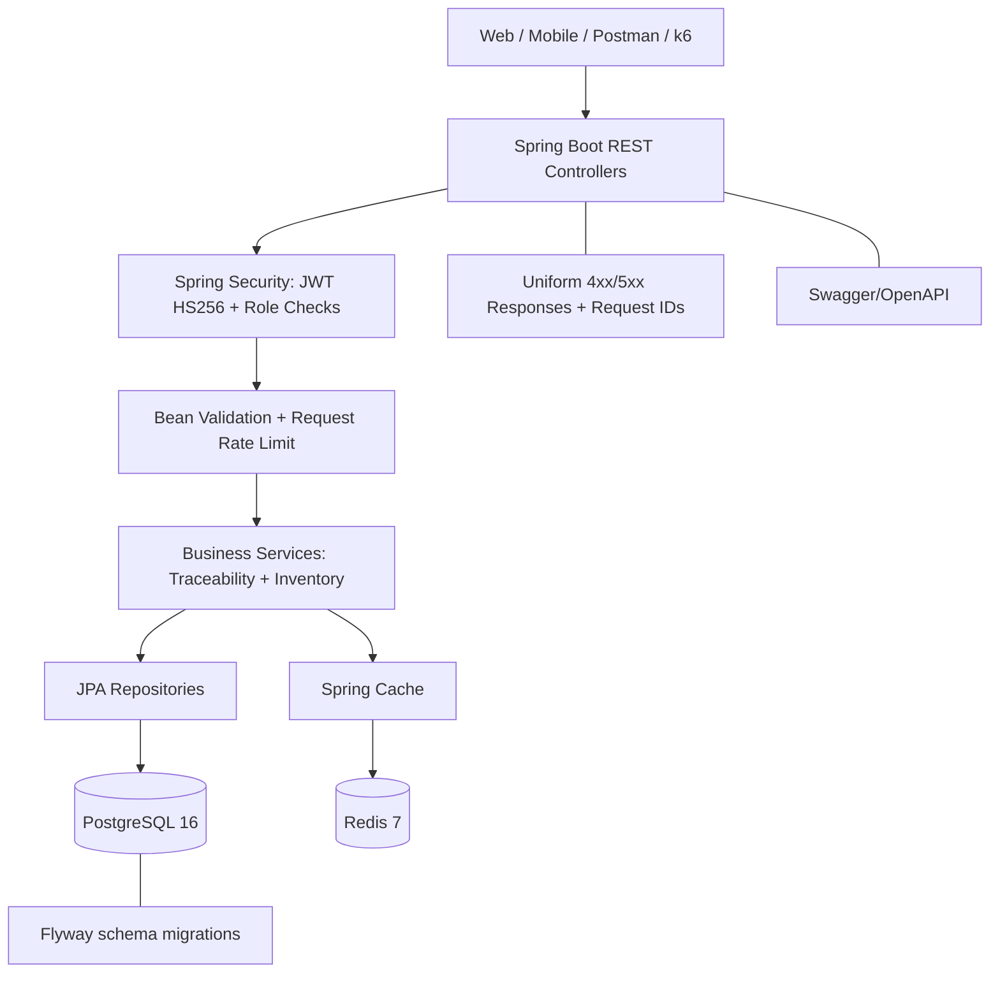

# Food Plant REST API — Spice Batch Traceability & Inventory

A **Java 21 / Spring Boot 3.5** REST API for a fictional Kochi spice-processing plant. Built as an internship assignment: three production lines, suppliers, lots, unique traceability IDs, audited material consumption, QA checks, JWT security, OpenAPI/Swagger, PostgreSQL, Redis, tests, and Docker Compose.

> **Project status:** Source code, sample fixtures, API specification, Postman requests, regression tests, CI configuration and k6 scenario are included. **CI acceptance passed on 21 November 2026**: 82/82 automated tests, 92.44% JaCoCo line coverage, 74/74 live API smoke checks, and a k6 200 RPS target scenario with 12,001 requests, zero HTTP failures, and 1.51 ms p95 latency on a GitHub-hosted runner. See [the successful GitHub Actions run](https://github.com/sheetanshumohan/Yuva-Intern-Project/actions/runs/44872259269) and [TEST_REPORT.md](TEST_REPORT.md).

## Quick start (Windows PowerShell / macOS / Linux)

You need **Docker Desktop** with Compose (recommended), or Java 21, Maven 3.9+, PostgreSQL 16 and Redis 7 for local development.

1. Clone/download the project. In PowerShell run:

   ```powershell
   Copy-Item .env.example .env
   ```

   On macOS/Linux use `cp .env.example .env`.
2. Open `.env`, replace **all** `CHANGE_ME` placeholders with strong, independent random values. Set JWT_SECRET to at least 32 bytes. Keep `.env` private. Leave `APP_SEED_ENABLED=true` for demo only. Set it to `false` for deployment.
3. Start the whole stack:

   ```bash
   docker compose up --build -d
   docker compose ps
   ```

4. Check that the application started (Flyway migration, then optional demo data):

   ```bash
   curl http://localhost:8080/actuator/health
   ```

5. Browse **Swagger UI:** `http://localhost:8080/swagger-ui.html`. The runtime OpenAPI YAML is available at `http://localhost:8080/v3/api-docs.yaml`. A source-controlled reference is in [`docs/openapi.yaml`](docs/openapi.yaml).
6. Log in with `admin@foodplant.local` and the value of `ADMIN_PASSWORD` **you configured** in `.env`, then paste the access token into Swagger **Authorize**. Role-specific demo users `staff@foodplant.local` and `viewer@foodplant.local` use `STAFF_PASSWORD` and `VIEWER_PASSWORD` respectively.
7. Import [`postman/FoodPlant.postman_collection.json`](postman/FoodPlant.postman_collection.json) into Postman. Execute **Authentication → login** once; its test script saves `{{token}}` automatically. For each ID-based request set collection variable `id` to a UUID obtained from a list/create endpoint.

**Login sample** (`$password` is your configured secret):

```bash
curl -X POST http://localhost:8080/api/v1/auth/login \
  -H 'Content-Type: application/json' \
  -d '{"email":"admin@foodplant.local","password":"YOUR_ADMIN_PASSWORD"}'
```

Send `Authorization: Bearer <accessToken>` on protected requests. The `GET /api/v1/production-lines/summary` endpoint is cached with Redis; others use PostgreSQL.

## One-command comprehensive verification

The project includes automated acceptance scripts. On **Windows PowerShell**, after configuring `.env`, run:

```powershell
powershell -ExecutionPolicy Bypass -File .\scripts\verify_all.ps1
```

On **Linux/macOS**, run `bash scripts/verify_all.sh`. These execute **real tests** using Docker-contained Maven and k6; no host Maven or k6 installation is necessary. They perform JUnit/MockMvc verification with a 75% JaCoCo line-coverage gate, build PostgreSQL/Redis/API containers, run a live HTTP test covering JWT, CRUD, validation, audit, Redis invalidation and concurrent stock locking, and exercise the cached summary endpoint at **200 requests/sec for 60 seconds** with a 300 ms p95 threshold. Results are saved in `verification/RESULTS.md` and original reports/logs. A failed gate stops the script.

Offline source checks, for environments with JDK 21, Python and PyYAML, can be run with `bash scripts/validate_offline.sh`. These cannot replace the real acceptance run. **Verification:** The authoring environment lacked Docker and Maven Central connectivity; the GitHub Actions runner subsequently executed and passed the full acceptance workflow. Performance measurements apply to that runner and scenario, not to an untested production deployment.

## Architecture



For ER relationships see [`docs/schema.mmd`](docs/schema.mmd). Every API layer returns DTOs, never JPA entities. There are no public endpoints that can register themselves as admins; creating users requires an existing admin JWT.

### Main entities

| Entity | Key fields | Design decision |
|---|---|---|
| `production_lines` | UUID, code, name, capacity kg/day | Three independently identifiable physical lines |
| `suppliers` | UUID, name, contact email, origin | Explicit FK used by lots and batches |
| `raw_material_lots` | UUID, lot code, supplier, stock kg, archived, version | Quantity normalized to kilograms; soft archive preserves full stock ledger |
| `batches` | UUID, **nonunique** batch number, line, supplier, product, input/output kg, shift, moisture, machine | Legacy batch numbers can be reused after a system reset; stable UUID distinguishes records |
| `quality_checks` | UUID, batch FK, moisture nullable, result, timestamp | Missing moisture in a night shift stays `NULL`, not zero |
| `material_usages` | UUID, batch FK, lot FK, quantity kg | Links each batch with its consumed raw-material lot |
| `inventory_movements` | UUID, lot FK, signed change kg, reason, time | Auditable stock ledger; negative means consumed/removed |
| `user_accounts` | UUID, email, BCrypt hash, role | No plaintext password storage |

Weights entering the API are submitted as `{ "value": 2500, "unit": "G" }` or `{ "value": 2.5, "unit": "KG" }`, normalized to `NUMERIC(14,3)` kg. Values smaller than 1 gram are rejected rather than silently rounded to zero.

**Legacy duplicates:** The seed includes two `B-001` records on `LINE-01` with distinct `producedAt` values and distinct UUIDs. `GET /api/v1/batches/lookup?batchNumber=B-001` intentionally returns both. Do not use `batchNumber` as a database primary key.

**Night shifts:** The seed deliberately contains missing moisture values in night-shift batch and quality records. They remain nullable. `PENDING` flags incomplete QA rather than making up a measurement.

## API endpoints (32)

| Resource | Endpoints | Allowed roles |
|---|---|---|
| Auth | `POST /auth/login`; `GET /auth/users`; `POST /auth/users` | Login: public; users: admin |
| Suppliers | `GET /suppliers`; `POST /suppliers`; `GET /suppliers/{id}`; `PUT /suppliers/{id}`; `DELETE /suppliers/{id}` | All roles read; staff/admin write; admin delete |
| Production lines | `GET /production-lines`; `GET /production-lines/summary`; `POST /production-lines`; `GET /production-lines/{id}`; `PUT /production-lines/{id}`; `DELETE /production-lines/{id}` | All read; staff/admin write; admin delete |
| Raw materials | `GET /raw-materials`; `POST /raw-materials`; `GET /raw-materials/{id}`; `PUT /raw-materials/{id}`; `DELETE /raw-materials/{id}`; `GET /raw-materials/{id}/movements`; `POST /raw-materials/{id}/adjustments` | All read; staff/admin write; admin delete |
| Batches | `GET /batches`; `GET /batches/lookup`; `POST /batches`; `GET /batches/{id}`; `PUT /batches/{id}`; `DELETE /batches/{id}`; `GET /batches/{id}/trace` | All read; staff/admin write; admin delete |
| Quality | `GET /batches/{id}/quality-checks`; `POST /batches/{id}/quality-checks` | All read; staff/admin add |
| Consumption | `GET /batches/{id}/materials`; `POST /batches/{id}/materials` | All read; staff/admin consume |

All routes above (except login) are prefixed with `/api/v1`. For filters, pagination, payloads, and status codes, see `docs/openapi.yaml` or Swagger UI. Pagination uses `page` (0-indexed) and `size` (1–100); search on batches uses `search`, `lineId`, `status`, and `shift`.

Example batch POST body:

```json
{
  "batchNumber": "B-NEW-002", "productName": "Ground Pepper",
  "productionLineId": "REPLACE_WITH_LINE_UUID", "supplierId": "REPLACE_WITH_SUPPLIER_UUID",
  "rawWeight": {"value": 3500, "unit": "G"},
  "outputWeight": {"value": 3.25, "unit": "KG"},
  "producedAt": "2026-11-21T08:30:00Z", "shift": "NIGHT",
  "moisturePercent": null, "status": "QUARANTINED", "machineCode": "MILL-1"
}
```

Example failure response:

```json
{
  "timestamp": "2026-11-21T08:30:00Z",
  "status": 400,
  "error": "Bad Request",
  "message": "Validation failed",
  "path": "/api/v1/batches",
  "fields": {"rawWeight.value": "must be greater than 0.0"}
}
```

## Business logic & data integrity

- Material creation writes an initial positive inventory movement and opening balance.
- `POST /raw-materials/{id}/adjustments` writes a signed ledger movement and adjusts stock **in one transaction**. The API rejects negative stock.
- `POST /batches/{id}/materials` takes pessimistic locks on both the batch and lot, verifies supplier consistency, available stock and total recorded consumption `<= rawWeightKg`, then saves usage + ledger entry + stock decrement atomically.
- A batch with QA or material consumption history cannot be deleted, preserving its audit trail. Material lots use soft deletion (`archived=true`), remain accessible by UUID for historical audit, and are excluded from the active material listing; archived lots cannot be adjusted or consumed. The stock balance must first be zero, with write-offs or transfers recorded as ledger movements. Supplier/line deletions with references are rejected by FK constraints.
- Batch updates cannot change raw weight or supplier after consumption. Changing identifying metadata in an already-audited record is allowed by this demo implementation but should be additionally restricted for a regulated plant.
- No JPA `OpenEntityManagerInView`; data is mapped inside transactional services.
- All changes use UUID identifiers for entity references; the legacy human-readable batch number is searchable but not unique.

## Security and OWASP API considerations

- BCrypt(12) password hashing; HMAC-SHA-256 JWT with issuer, issue/expiry, 60-minute default TTL.
- `ADMIN` may manage accounts and delete unreferenced objects; `STAFF` can create/update and consume stock; `VIEWER` is read-only.
- Method-level authorization + authenticated-by-default routes, stateless sessions, JSON validation, no raw exception stack traces to clients.
- Fixed-window IP throttling (default 15,000 req/min for general API and 30 req/min for login), 429 + `Retry-After`; no trust of spoofable forwarded-IP headers.
- Transactional locking, FK references, nonnegative stock and quantity limits guard stock integrity.
- Spring Data derived/specification queries avoid hand-built SQL; `size` is capped to prevent huge page responses.
- Request IDs returned as `X-Request-ID`; Spring Boot Logstash-format structured JSON logging. Secrets are environment variables; `.env` is git-ignored.
- **Current limitations:** Rate limit is per process (use a Redis/edge limiter for multiple API replicas); no TLS termination is included (terminate HTTPS at a reverse proxy); JWT revocation/refresh and per-user active-status checks after issuance are not implemented; Redis is trusted only on the private Compose network. See [`docs/SECURITY.md`](docs/SECURITY.md).

## Tests, coverage and performance

Run unit and HTTP integration tests (H2 in PostgreSQL compatibility mode; production PostgreSQL is used in Docker):

```bash
mvn -B clean verify
```

- JaCoCo report: `target/site/jacoco/index.html`.
- JUnit XML reports: `target/surefire-reports/`.
- The Maven `verify` phase **enforces ≥75% line coverage**. The project has test cases for validation, login, RBAC, CRUD, filtering, grams/kg, null moisture, reused batch number, QA, trace, audit, archiving and stock conflicts.
- CI workflow also builds the Docker service and runs live PostgreSQL/Redis smoke and k6 load checks on GitHub Actions.
- The CI run on 21 November 2026 passed **82 tests**, with **92.44% line coverage**, exceeding the minimum 75% gate. Evidence and execution details are recorded in [`TEST_REPORT.md`](TEST_REPORT.md).

Simulated festival production ramp-up (requires [k6](https://grafana.com/docs/k6/latest/set-up/install-k6/)):

```bash
k6 run -e BASE_URL=http://localhost:8080 \
  -e LOGIN_EMAIL=viewer@foodplant.local \
  -e LOGIN_PASSWORD='YOUR_VIEWER_PASSWORD' \
  loadtest/festival-ramp.js
```

The scenario logs in once and drives **200 requests per second for 60 seconds** against the Redis-cached summary endpoint, with `p(95)<300 ms`, `<1%` failure and zero dropped iterations as thresholds. These targets were **measured in CI on 21 November 2026**: 12,001 requests at approximately 199.13 requests/sec averaged over the run, 1.51 ms p95 HTTP latency, and zero HTTP failures. Results can differ on other hardware; see [`TEST_REPORT.md`](TEST_REPORT.md).

## Project layout

```text
food-plant-rest-api/
├── src/main/java/com/foodplant/
│   ├── config/       # JWT, role security, rate limiting, logging, seed data
│   ├── controller/   # HTTP API
│   ├── dto/          # API request/response models
│   ├── entity/       # JPA entities and enums
│   ├── exception/    # Centralized error format
│   ├── repository/   # Spring Data JPA repositories
│   └── service/      # Business rules + stock integrity
├── src/main/resources/db/migration/  # Flyway V1 schema and V2 archive migration
├── src/test/         # Unit and authenticated MockMvc HTTP tests
├── docs/             # OpenAPI, ER diagram, architecture & security
├── fixtures/         # Synthetic manufacturing, material and QA records
├── postman/          # Importable collection
├── loadtest/         # 200 RPS k6 scenario
├── scripts/          # Reproducible API artifacts generator
├── .github/workflows/ci.yml
├── Dockerfile
├── docker-compose.yml
├── pom.xml
└── TEST_REPORT.md
```

## Decisions to explain during interview

**Why PostgreSQL?** ACID transactions, composite filtering, numeric precision, FK constraints and row-level locks suit auditable inventory.

**Why UUID instead of batch number?** A reset reused the same batch number on the same production line, so a text batch number does not uniquely identify one physical event.

**Why allow nullable moisture?** Night-shift QA data is unknown, not necessarily zero; using `NULL` plus a pending QA result preserves the uncertainty rather than inventing data.

**Why Redis here?** Caching the most frequent read (`production-lines/summary`) removes repeated DB reads; write operations evict the cached view. Inventory mutations and writes are **never cached**.

**Why row locks?** Two concurrent requests must not both see the same available stock or simultaneously exceed one batch's raw weight. Pessimistic locks serialize updates.

**How to improve for production?** Use read-only probes and security monitoring, distributed Redis rate limiting, TLS gateway, JWT key rotation / revocation, trace/audit append-only policies, DB integration tests with Testcontainers, metrics and distributed load tests.

## Deliverables included

- Source code with layered Spring Boot architecture and >15 REST routes
- PostgreSQL Flyway SQL migration and realistic synthetic fixtures
- Swagger at runtime + versioned `docs/openapi.yaml`
- Postman collection with auto-saved login JWT
- MockMvc API tests, unit tests and JaCoCo coverage gate
- Dockerfile, Compose (API, PostgreSQL, Redis, Maven test runner and k6 runner), `.env.example`
- k6 load script and CI pipeline
- Architecture diagram, ER diagram, data dictionary and security notes
- Verified CI test report, including JUnit, coverage, live integration and k6 results

No real supplier/customer data or credentials are committed. The repository source can be pushed to a GitHub account after local verification.

## Publishing as your GitHub repository

The project is already published at [sheetanshumohan/Yuva-Intern-Project](https://github.com/sheetanshumohan/Yuva-Intern-Project). Clone it with:

```bash
git clone https://github.com/sheetanshumohan/Yuva-Intern-Project.git
cd Yuva-Intern-Project
```

Don't add `.env`, real credentials, generated coverage output or personally identifying supplier data. GitHub Actions automatically runs the coverage gate on push.

### Material safety rules

Stock adjustment requests must explicitly provide the `increase` boolean (omitting it is a 400).
Batches reject inactive suppliers and inactive production lines. Raw-material lots with a past
expiry date are rejected for production consumption. Quality checks reported as `PASS` must
include a measured moisture value; `PENDING` may have `null` moisture. Material updates use `MaterialUpdateRequest` (no openingStock field), and unknown JSON request fields are rejected instead of silently discarded.
